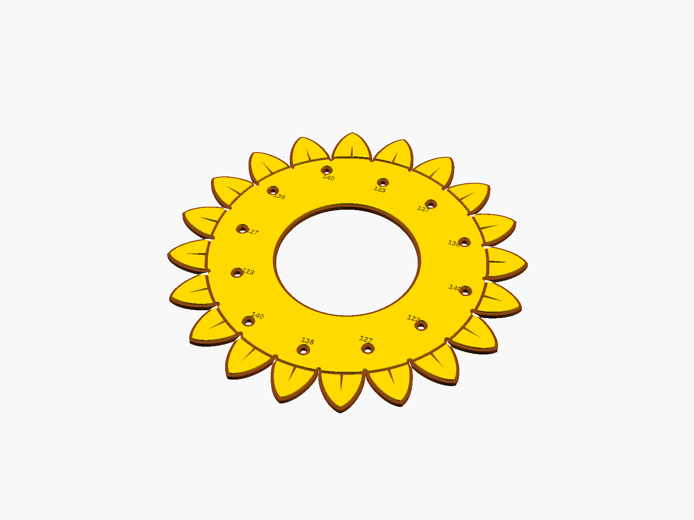
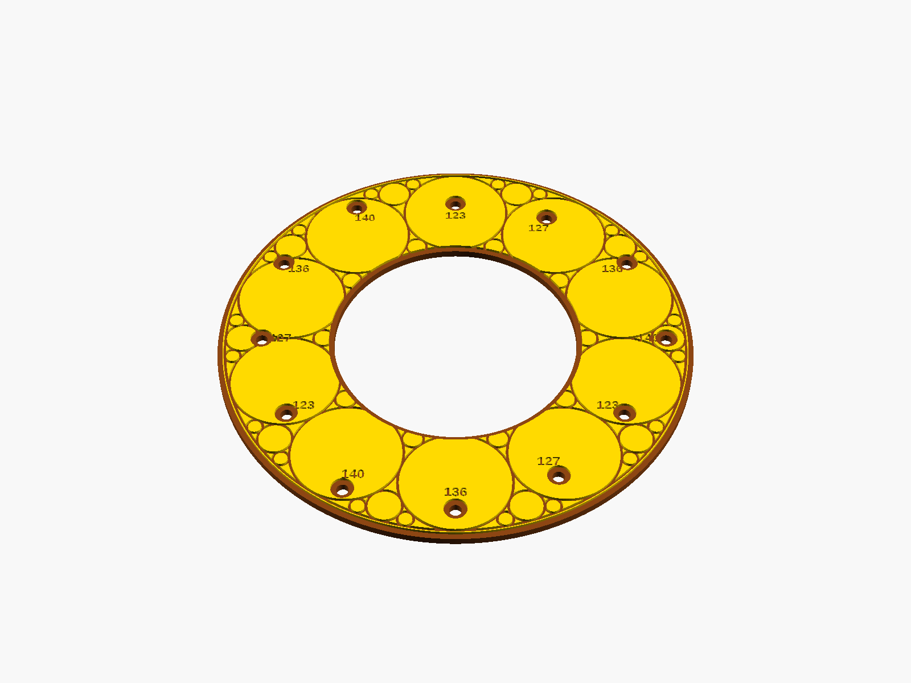

# brass-reflector

Parametric **bell reflectors** for trumpet, trombone and euphonium. A reflector is a flat ring that mounts on the bell. It has three mounting holes for each supported bell size, so one plate fits several bells.

The outer edge can be a plain **circle** or a **sunflower**, which adds pointed petals around the ring. The ring face can have an **Apollonian gasket** pattern: circles packed inside circles around the large centre opening. The 3D version can print either design in **two colours**: a brown base with a yellow top, and the brown showing through only as lines.

| Sunflower | Apollonian gasket |
|---|---|
|  |  |
| `shape="sunflower"`, `two_tone=true` | `pattern="apollonian"`, `two_tone=true` |

*Both are the trumpet preset. The STLs are in [`samples/`](samples/). The edge shape and the pattern can be combined.*

There are two generators. They use the same presets and put the holes in the same places:

| File | Output | For |
|---|---|---|
| [`draw_reflector.py`](draw_reflector.py) | True-size 2D **SVG**. Red lines are cut paths and blue text is engraved labels. | Laser cutting |
| [`reflector.scad`](reflector.scad) | Solid 3D plate (**STL**) with the labels engraved into the top face | 3D printing |

> ⚠️ **The geometry is provisional.** The hole offset from the bell rim (`offset`) is an assumption, not a measured value. The ring diameters are also unverified. Check the fit on the real instrument before you cut or print a final part. A paper print of the SVG is a cheap first test.

## Requirements

- **SVG:** Python 3.8+ (it needs `math.dist`). Only the standard library is used, so there is nothing to install.
- **STL:** [OpenSCAD](https://openscad.org) 2019.05 or newer, because it needs `assert`. Tested with 2021.01.
  - On macOS the command-line program is inside the app bundle, so it may not be on your `PATH`. Either call it directly, for example `/Applications/OpenSCAD-2021.01.app/Contents/MacOS/OpenSCAD`, or make an alias:
    ```bash
    alias openscad=/Applications/OpenSCAD-2021.01.app/Contents/MacOS/OpenSCAD
    ```

## Quick start

```bash
git clone https://github.com/icetuba/brass-reflector.git
cd brass-reflector

# Laser cutting: SVG (default preset is euphonium → euphonium_reflector.svg)
python3 draw_reflector.py --instrument trumpet

# 3D printing: STL
openscad -o trumpet_reflector.stl -D 'instrument="trumpet"' reflector.scad

# Sunflower edge, in either generator
python3 draw_reflector.py --instrument trumpet --shape sunflower
openscad -o trumpet_sunflower.stl -D 'instrument="trumpet"' -D 'shape="sunflower"' reflector.scad

# Apollonian gasket pattern, in either generator
python3 draw_reflector.py --instrument trumpet --pattern apollonian
openscad -o trumpet_apollonian.stl -D 'instrument="trumpet"' -D 'pattern="apollonian"' reflector.scad
```

Both print a summary line and a reminder that the geometry is provisional:

```
trumpet reflector: 12 holes, outer 180 mm, inner 92 mm, ... min outer edge clearance 7.75 mm
WARNING: Offset and ring dimensions are provisional; confirm geometry before fabrication.
```

## Presets

All dimensions are in **millimetres**.

| Instrument | Bell diameters (mm) | Outer (mm) | Inner (mm) |
|---|---|---|---|
| Trumpet | 123, 127, 136, 140 | 180 | 92 |
| Trombone | 203.2, 215.9, 228.6, 254 (8, 8.5, 9, 10 in) | 300 | 150 |
| Euphonium | 266.7, 279.4, 292.1, 304.8 (10.5, 11, 11.5, 12 in) | 360 | 190 |

All three presets produce valid 12-hole layouts in both generators. Any value you set yourself replaces the preset value.

## How the geometry works

The plate is centred on the origin.

1. **Hole radius.** For a bell of diameter `B`, its holes sit on a circle of radius `B/2 + offset`.
2. **Hole angles.** Each bell gets 3 holes, 120° apart. With `n` bell sizes, the bells are offset by `360°/(3n)` from each other, so the `3n` holes are evenly spaced. Example: with 4 bells, there is a hole every 30°, and the bell sizes take turns around the ring. The first bell's first hole is at the top, and the bell sizes go clockwise.
3. **Labels.** Each hole gets a label showing the **bell diameter** it belongs to. The label sits 7 mm closer to the centre than the hole, so you can tell which hole is for which bell.

### Sunflower shape

With `shape` set to `sunflower`, the outer circle is replaced by a ring of pointed petals:

- **The petals sit outside `outer`.** The notches between the petals touch the outer circle, and the petal tips reach `outer/2 + petal_length`. The solid ring inside `outer` doesn't change, so the holes, the labels and every clearance check stay exactly as they are with a circle.
- **The part gets bigger.** The overall diameter is `outer + 2 × petal_length`, and the summary line prints it.
- **Defaults:** 20 petals, and a petal length of 15% of `outer`. That gives these overall sizes: trumpet 234 mm, trombone 390 mm and euphonium 468 mm.
- **Petal outline:** across each petal, the radius follows `outer/2 + petal_length · cos(πu/2)^0.6 · (1 − 0.25|u|)`, where `u` goes from −1 to 1. A petal tip sits at the top.

### Apollonian gasket pattern

With `pattern` set to `apollonian`, the ring face is decorated with an [Apollonian gasket](https://en.wikipedia.org/wiki/Apollonian_gasket):

1. **The centre opening stays exactly `inner`.** The pattern is built around it.
2. **Main ring of circles.** `n` equal circles (a [Steiner chain](https://en.wikipedia.org/wiki/Steiner_chain)) each touch the opening, their two neighbours and a boundary circle. With an opening of radius `r`, the boundary radius is `r · (1 + sin(π/n)) / (1 − sin(π/n))`. The script picks the smallest `n` that keeps the boundary at least 2 mm inside the outer edge, which gives 10 circles for trumpet and trombone and 11 for euphonium. The first circle is at the top.
3. **Filling the gaps.** Every curved triangle between touching circles is filled with the circle that touches all three sides, found with [Descartes' circle theorem](https://en.wikipedia.org/wiki/Descartes%27_theorem). This repeats until the circles get smaller than `pattern_min` (default radius 2 mm). That gives 50 circles for trumpet, 110 for trombone and 121 for euphonium.

The pattern is **drawn as lines, not cut out**. The mounting holes sit across the pattern, so cutting out the circles would weaken the plate around them. The lines are:

- **SVG:** blue score lines in `<g id="score-pattern">`
- **STL, one colour:** engraved `label_depth` deep, `pattern_line` wide (1 mm)
- **STL, two colours:** gaps in the yellow top layer, so they show brown

The pattern works with either outer edge. Both generators produce the same circles.

### Validation checks

If any check fails, no file is written. Python raises a `ValueError`, and OpenSCAD stops with an `assert` error.

| Check | Condition | SVG | STL |
|---|---|:-:|:-:|
| Ring sizes | `0 < inner < outer` | ✓ | ✓ |
| Hole and offset | `hole > 0` and `offset ≥ 0` | ✓ | ✓ |
| Bells | At least one bell, and every diameter is greater than 0 | ✓ | ✓ |
| Outer edge | Every hole fits inside the outer edge. The error says how far it overshoots. | ✓ | ✓ |
| Hole spacing | Hole centres are at least `hole + 1` mm apart (in the STL, `hole + min_web`) | ✓ | ✓ |
| Centre opening | Every hole stays clear of the centre opening | — | ✓ |
| Thickness and engraving | `thickness > 0` and `0 < label_depth < thickness` | — | ✓ |
| Sunflower | At least 3 petals (the SVG script also requires `petal_length > 0`) | ✓ | ✓ |
| Pattern | `pattern_min > 0` (and in the STL, `pattern_line > 0`). The gasket must fit between `inner` and `outer`. | ✓ | ✓ |
| Two-tone | Needs `shape="sunflower"` or a pattern, `part="top"` needs `two_tone`, and `top_thickness` and `line_width` must be greater than 0 | — | ✓ |

## Laser cutting: `draw_reflector.py`

```bash
python3 draw_reflector.py                                   # euphonium_reflector.svg
python3 draw_reflector.py --instrument trombone --output trombone_v2.svg
python3 draw_reflector.py --instrument trombone --bells 210 230 250 --outer 310 --inner 160
```

| Option | Default | Description |
|---|---|---|
| `--instrument` | `euphonium` | `trumpet`, `trombone` or `euphonium` |
| `--bells D [D ...]` | from preset | Bell diameters. Each one adds 3 holes. |
| `--outer` | from preset | Outside diameter |
| `--inner` | from preset | Centre opening diameter |
| `--offset` | `10` | How far each hole sits outward from the bell's rim, measured along the radius. **Provisional.** |
| `--hole` | `4.5` | Hole diameter. 4.5 mm is a standard M4 clearance hole. |
| `--thickness` | `3` | For reference only. The SVG does not use it. |
| `--shape` | `circle` | `circle` or `sunflower` |
| `--petals` | `20` | Number of petals (sunflower only) |
| `--petal-length` | 15% of `--outer` | How far the petals reach beyond `--outer` |
| `--pattern` | `none` | `none` or `apollonian` |
| `--pattern-min` | `2` | Smallest circle radius in the pattern, in mm |
| `--output` | `<instrument>_reflector.svg` | Where to write the SVG |

### SVG output

- The `width` and `height` are set in `mm`, so the file opens at true size in Inkscape, LightBurn and similar tools. The canvas is the overall diameter plus 16 mm, square.
- `<g id="laser-cut">`: the outer edge (a circle, or a sunflower `<path>`), the inner circle and every hole. Red (`#ff0000`), 0.1 mm stroke, no fill.
- `<g id="engrave-labels">`: the bell-diameter labels. Blue (`#0055ff`), 3.7 mm sans-serif.
- `<g id="score-pattern">`: the Apollonian circles, only when a pattern is on. Blue 0.1 mm stroke, no fill.

In your laser software, set red to **cut** and blue to **engrave** or **score**.

### Using it from Python

```python
from draw_reflector import svg

svg(instrument='trumpet', bells=[123, 127, 136, 140], outer=180, inner=92,
    offset=10, hole_diameter=4.5, thickness=3, output='trumpet.svg')
```

## 3D printing: `reflector.scad`

```bash
openscad -o euphonium_reflector.stl reflector.scad
openscad -o trumpet.stl -D 'instrument="trumpet"' -D 'thickness=4' -D 'hole=4.8' reflector.scad
openscad -o custom.stl  -D 'instrument="trombone"' -D 'bells=[210,230,250]' -D 'outer=310' reflector.scad
```

You can also open the file in the OpenSCAD GUI and change the values in the **Customizer** panel. A full render (F6) takes about 15–30 seconds for a plain or sunflower plate. With the Apollonian pattern it takes 30 seconds to 2.5 minutes, depending on the instrument and on two-tone.

| Parameter | Default | Description |
|---|---|---|
| `instrument` | `"euphonium"` | The preset to use |
| `bells`, `outer`, `inner` | `[]`, `0`, `0` | Overrides. Leave them empty or at 0 to use the preset. |
| `offset` | `10` | Same as `--offset`. **Provisional.** |
| `hole` | `4.5` | Hole diameter. Printed holes usually come out small, so consider 4.7 to 4.8 for M4. |
| `min_web` | `1` | Minimum material left between two holes |
| `thickness` | `3` | Plate thickness |
| `shape` | `"circle"` | `"circle"` or `"sunflower"` |
| `petals` | `20` | Number of petals (sunflower only) |
| `petal_length` | `0` | How far the petals reach beyond `outer`. 0 means 15% of `outer`. |
| `pattern` | `"none"` | `"none"` or `"apollonian"` |
| `pattern_min` | `2` | Smallest circle radius in the pattern |
| `pattern_line` | `1` | Width of the pattern lines |
| `labels` | `true` | Turns the engraved labels on or off |
| `label_size`, `label_depth`, `label_inset`, `label_font` | `3.7`, `0.6`, `7`, Liberation Sans Bold | How the labels look and where they sit |
| `two_tone` | `false` | Adds the yellow top layer (needs the sunflower or a pattern). See below. |
| `part` | `"all"` | Which part to export: `"all"`, `"base"` or `"top"` |
| `top_thickness` | `1.2` | Thickness of the top layer |
| `line_width` | `2` | Width of the outlines around and between petals |
| `vein_length` | `0.55` | Length of the vein slit in each petal, as a fraction of the petal length. 0 turns veins off. |
| `base_color`, `top_color` | `"SaddleBrown"`, `"Gold"` | Colours in the preview only. An STL has no colour. |
| `ring_fn`, `hole_fn` | `256`, `48` | Curve smoothness, as the number of segments per circle |

Print it flat, with the engraved face up. You don't need supports.

### Two-tone

With `two_tone=true`, a second layer is added on top of the plate. It needs `shape="sunflower"` or `pattern="apollonian"`, or both. It's built like a layered wooden sign:

- **Base layer** (`thickness`, brown): the whole sunflower plate, including the centre opening and the mounting holes.
- **Top layer** (`top_thickness`, yellow): covers the **whole top face**. Gaps of width `line_width` let the brown show through as lines:
  - around the outside edge
  - a rim around the centre opening and around each mounting hole
  - the bell-diameter labels, which are cut through the yellow
  - with the sunflower: gaps between the petals, a circle between the ring and the petals, and a tapered vein slit in each petal
  - with the pattern: every gasket circle, `pattern_line` wide

```bash
# Single-nozzle printer: one STL, change filament at the height printed in the console (Z = thickness)
openscad -o sunflower.stl -D 'instrument="trumpet"' -D 'shape="sunflower"' -D 'two_tone=true' reflector.scad

# Multi-colour printer (AMS, MMU, IDEX): export the two parts and load them as one object
openscad -o sunflower_base.stl -D 'instrument="trumpet"' -D 'shape="sunflower"' -D 'two_tone=true' -D 'part="base"' reflector.scad
openscad -o sunflower_top.stl  -D 'instrument="trumpet"' -D 'shape="sunflower"' -D 'two_tone=true' -D 'part="top"'  reflector.scad
```

## Known limitations

- **Provisional offset.** It isn't based on measurements. In `draw_reflector.py` the docstring calls it `contact_offset`, which is the same value as `--offset`.
- **Labels aren't checked for collisions.** With tight dimensions, labels can overlap the inner edge or each other. Look at the output before you use it.
- **The SVG script doesn't check the centre opening.** A large `--inner` with small bells can put holes inside the opening, and you get no error. The STL version does check this.
- **Zero values fall back to the preset.** In both generators, `outer`/`inner` set to 0 counts as "not given", so the preset value is used and you get no error.
- **Large parts may not fit your machine.** A plain trombone or euphonium ring is 300–360 mm across, and a sunflower is up to 468 mm. Most 3D-printer beds and many laser beds are smaller. You could print it in sections, use shorter petals, or check the size before you start.
- **Python errors show as tracebacks.** The actual message is on the last line.
